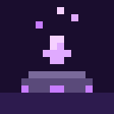

### RitualRivival

is the revival system of your project: it sends dead players to a configurable limbo waiting area and lets other players bring them back through a multiblock ritual (altar + soul orb). It does not store items itself; instead, it retrieves a player's grave data via the graveId and returns their items upon successful revival. Limbo spawn, ritual structure, and countdown are fully configurable, and the plugin can run standalone or as part of the larger death-to-revival chain.

 

## Plugin Dependencies

| Plugin | Required? | Purpose |
|---|---|---|
| **SoulGraves** | Optional | Grave data, soul orb detection, item return. Without it: items drop normally, no grave/orb binding |
| **Nexo** / **ItemsAdder** / **Oraxen** | Optional (one of them) | Custom ritual blocks & orb item detection |